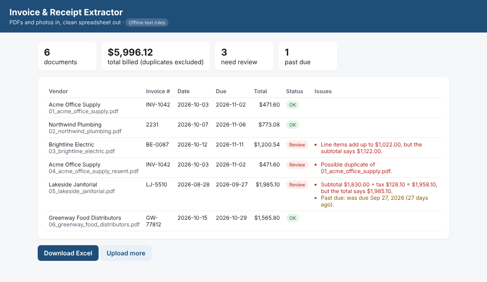

# Invoice & Receipt Extractor

Drop in a stack of vendor invoices and receipts and get **a clean Excel file**, plus a list of the bills that need a closer look: math errors, duplicates, missing details and past-due invoices.

Built for small businesses and bookkeepers who still type invoices into spreadsheets or accounting software by hand.



## What it does

1. **Reads each document** into vendor, invoice number, invoice and due dates, line items, subtotal, tax and total.
2. **Checks every bill:**
   - each line's quantity × unit price matches its amount
   - the line items add up to the subtotal
   - subtotal + tax equals the total
   - the same bill hasn't been uploaded twice (same vendor and invoice number, or same vendor, date and amount)
   - nothing important is missing, and flags anything past due
3. **Exports to Excel** with three sheets (Invoices, Line items, Issues). Rows that need review are highlighted, and a total is calculated with a formula.

The sample set includes three planted problems, and the app catches all three: a subtotal that's $100 too high, an invoice sent twice, and a total that doesn't match the subtotal plus tax.

## Two modes

| | Offline text rules (default) | Claude AI (with an API key) |
|---|---|---|
| Typed PDFs with common labels | ✓ | ✓ |
| Any layout, any wording | Limited | ✓ |
| Scanned PDFs and phone photos of receipts | ✗ (flagged for review) | ✓ |
| Cost | Free | A few cents per document |

In both modes the checks run in plain Python, so the AI's reading is always double-checked by the math.

## Run it

```bash
pip install -r requirements.txt
uvicorn app.main:app --reload
```

Open http://localhost:8000 and click **Try it with 6 sample invoices**, or upload your own PDFs.

To turn on Claude, copy `.env.example` to `.env`, add `ANTHROPIC_API_KEY=sk-ant-...`, and restart. Then try the photo in `sample_data/receipts/`.

- Docker: `docker build -t invoice-extractor . && docker run -p 8000:8000 -e ANTHROPIC_API_KEY invoice-extractor`
- Tests: `pytest -q`
- Rebuild the sample invoices: `python sample_data/make_samples.py`

## API

| Method | Path | Purpose |
|---|---|---|
| POST | `/api/extract` | Upload one or more files (`files` field). Returns extracted invoices, issues and `excel_url`. |
| GET | `/api/batches/{id}` | Results for a batch |
| GET | `/batches/{id}.xlsx` | Excel download |

To fully automate it, point an email inbox (via Zapier, Make or n8n) at `/api/extract`, and push the clean rows into QuickBooks, Xero or Google Sheets.

## Project layout

```
app/extract.py   PDF/image → fields (Claude tool call with the file attached, or text rules via pdfplumber)
app/checks.py    math, duplicate, missing-field and due-date checks
app/export.py    Excel workbook (openpyxl)
app/main.py      upload page and REST API (FastAPI)
sample_data/     fictional invoices and a receipt photo
```

## Production notes

Batches are kept in memory. For real use, store results in a database, keep the original files in cloud storage, and add login. All vendors and amounts in the samples are fictional.
